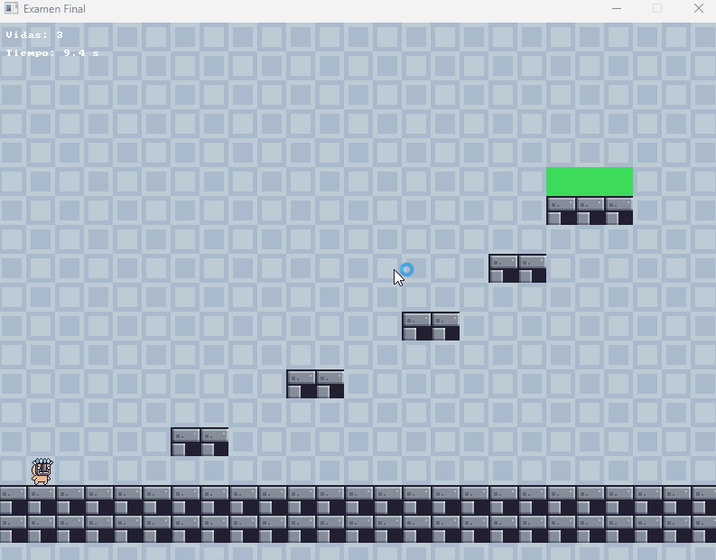

# 🏃 The Rescue

A 2D platformer built in **C++** with **SDL3**, developed as a final exam project for a game development course. The player must jump across platforms and reach the exit zone without falling into the void.

---

## 🎮 About the game

Guide the character across a hand-crafted level made of solid platforms at different heights, timing jumps carefully to avoid falling off the map. Reach the green exit tile to win.

- **Win condition:** touch the exit zone.
- **Lose condition:** fall off the map 3 times (3 lives total).

---

## 🕹️ Controls

| Key | Action |
|---|---|
| `A` / `←` | Move left |
| `D` / `→` | Move right |
| `SPACE` / `W` / `↑` | Jump (only while grounded) |
| `ESC` | Quit game |

---

## ✨ Features

- **Physics-based movement:** gravity and grounded-only jump
- **Tile-based level:** 18×25 grid map
- **AABB collision** against the tilemap
- **Animation states:** Idle / Run / Jump / Fall
- **Lives and respawn:** 3 lives
- **Audio:** looping music and sound effects
- **HUD:** lives counter and elapsed time

---

## 🛠️ Tech stack

- **C++**
- **SDL3**
- **SDL3_image**
- **SDL3_mixer**

---

## 🧠 Technical highlights

- **Tilemap-driven level design:** the level is a character-grid data structure decoupled from rendering, so it can be edited by changing a string array. The 18×25 map uses three tile types (air, solid, exit) drawn from a 16×16 tileset scaled 2x to 32×32 on screen.
- **Axis-separated AABB collision:** horizontal and vertical collisions are resolved independently per frame, preventing tunneling through blocks; vertical velocity resets to zero on landing. Ground detection checks the tile beneath the player's center, which keeps the logic simple; known limitation: partial support on platform edges is not detected.
- **Physics constants:** gravity of 1000 px/s² and a fixed jump impulse of −450 px/s, triggered only while grounded.
- **State-driven animation:** each state (Idle, Run, Jump, Fall) maps to its own sprite strip, with ~0.1 s per frame and horizontal flipping based on movement direction.
- **Runtime-computed animation frame counts:** frame counts are derived at load time from each spritesheet's texture width (`textureWidth / frameWidth`) instead of being hardcoded, so the system tolerates spritesheet changes.
- **Audio integration:** built on SDL3_mixer's Track/Mixer API, with a dedicated track for looping music and a separate track for one-shot effects (jump, death).
- **Delta-time-based simulation:** movement, physics, and animation timing are frame-rate independent, driven by a clamped delta time to avoid instability on frame spikes.
- **HUD:** lives and elapsed time rendered via `SDL_RenderDebugTextFormat`, plus a large win/lose message at the end of the run.

---

## 🏗️ Project structure

This project follows a single-file architecture (`Lazaro_EF.cpp`), as required by the exam format. Despite the single-file constraint, the code is organized into clear responsibility areas:

| Section | Responsibility |
|---|---|
| `g_map[]` | Tilemap data (18×25 grid: air / solid / exit) |
| `Player` struct | Player state: position, velocity, grounded flag, facing direction, animation state |
| `Anim` struct / `LoadAnim()` | Spritesheet loading with runtime frame-count calculation |
| `isSolid()` / `isGoal()` / `rectHitsSolid()` / `rectHitsGoal()` | Tile-based collision queries (AABB vs. tilemap) |
| Main loop — input | Keyboard polling, jump trigger (edge-detected via event, grounded-gated) |
| Main loop — physics | Gravity integration, axis-separated movement and collision resolution |
| Main loop — game rules | Win/lose conditions, lives, respawn logic |
| Main loop — animation | State selection (Idle/Run/Jump/Fall) and frame timing |
| Main loop — render | Background tiling, tilemap rendering, character sprite, HUD, win/lose banner |

---

## 🎨 Asset credits

Character, terrain, and background sprites, as well as sound effects and music, were provided by the course instructor as part of the exam template. The original authors and licenses of these assets are not known to the author of this repository.

These assets are **not** covered by this project's MIT license.

---

## ▶️ Play without building

Download the latest version from [Releases](https://github.com/LuisLazaroMachado/game-rescue-platformer/releases/latest) (Windows x64: unzip and run).

> Windows may show a SmartScreen warning because the executable is unsigned: click **More info → Run anyway**.

---

## 🚀 Building from source

This project relies on external native libraries that are not included in the repository (due to size).

**Requirements:** Visual Studio 2026 (v18.1, MSVC, x64), C++17, SDL3 3.4.1, SDL3_image 3.4.8, SDL3_mixer 3.4.1.

1. Clone the repository.
2. Download the **VC** (not MinGW) development versions of:
   - [SDL3](https://github.com/libsdl-org/SDL/releases)
   - [SDL3_image](https://github.com/libsdl-org/SDL_image/releases)
   - [SDL3_mixer](https://github.com/libsdl-org/SDL_mixer/releases)
3. Place them on your system and configure the include/library paths in Visual Studio project properties (**C/C++ → General → Additional Include Directories**, **Linker → General → Additional Library Directories**, **Linker → Input → Additional Dependencies**), pointing to your SDL3 installation.
4. Build in `Debug` or `Release` mode for `x64`.
5. Run the generated `.exe`. Make sure `SDL3.dll`, `SDL3_image.dll`, and `SDL3_mixer.dll` are next to it, along with the `assets/` folder.

---

## ⚠️ Known limitations & next steps

- Single level, no menu or pause
- No gamepad support
- Ground check uses the player's center only
- Single-file architecture (exam requirement)

---

## 👤 Author

**Luis Lazaro Machado** — [GitHub](https://github.com/LuisLazaroMachado)

---

## 📄 License

This project's code is distributed under the MIT License. See [LICENSE](LICENSE) for details.
